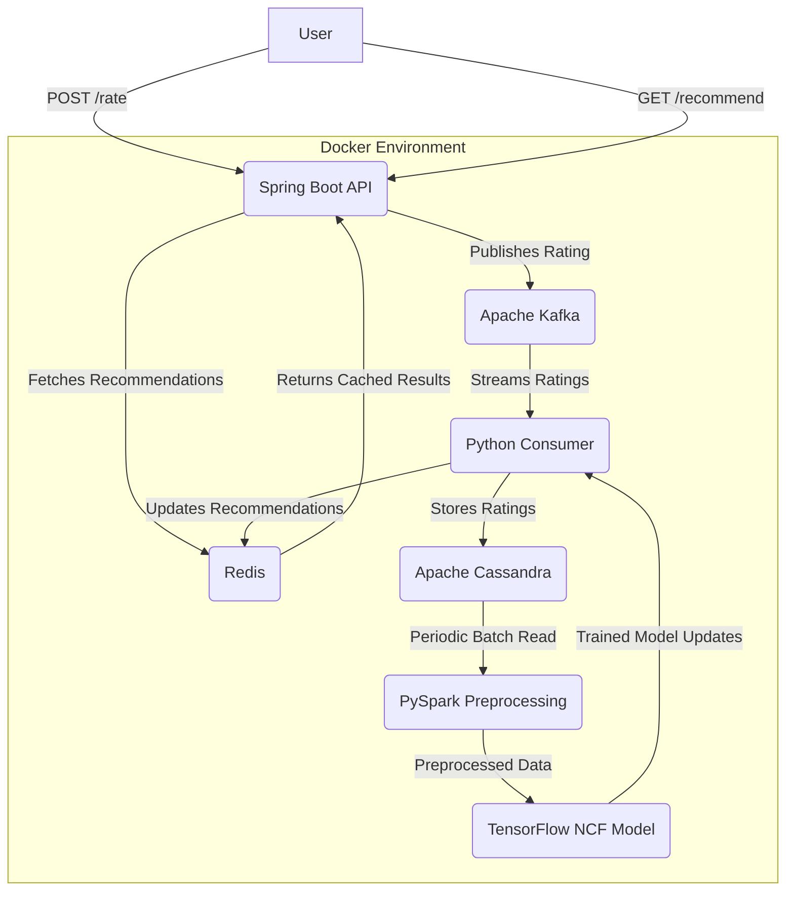

# Real-Time Recommendation Pipeline

A production-like recommendation system built with a modern, scalable tech stack. This project demonstrates real-time rating ingestion, distributed data processing, and neural collaborative filtering (NCF) to deliver personalized movie recommendations. Designed to mimic systems at companies like Netflix or TikTok, it leverages Dockerized microservices, event streaming, and deep learning.

## Features
- **Real-Time Rating Ingestion**: Users submit ratings via a REST API, processed asynchronously.
- **Scalable Architecture**: Event-driven with Kafka, persistent storage in Cassandra, and caching in Redis.
- **Advanced Recommendations**: Neural Collaborative Filtering (NCF) model from TensorFlow Recommenders.
- **Big Data Processing**: PySpark for preprocessing large datasets.
- **Containerized Deployment**: Fully Dockerized for easy setup and scalability.

## Tech Stack
- **Backend**: Spring Boot (Java) with Spring Data Cassandra (ORM)
- **Event Streaming**: Apache Kafka
- **Database**: Apache Cassandra
- **Caching**: Redis
- **Data Processing**: PySpark
- **Machine Learning**: TensorFlow Recommenders (NCF)
- **Containerization**: Docker + Docker Compose

## Architecture



1. **Spring Boot API**: Handles `POST /rate` (sends ratings to Kafka) and `GET /recommend` (fetches from Redis).
2. **Kafka**: Queues ratings for async processing.
3. **Cassandra**: Stores ratings persistently.
4. **PySpark**: Preprocesses ratings into training data.
5. **TensorFlow NCF**: Trains a neural model and generates recommendations.
6. **Redis**: Caches recommendations for low-latency access.

## Prerequisites
- Docker & Docker Compose
- Java 17 (for Spring Boot development)
- Python 3.9+ (for consumer scripts)
- Maven (for building Spring Boot)

## Setup & Installation
1. **Clone the Repository**:
   ```bash
   git clone https://github.com/cherylcy/scalable-recommendation-engine.git
   cd scalable-recommendation-engine
   ```

2. **Start Services**:
   ```bash
   docker-compose up -d
   ```

3. **Build Spring Boot API**:
   ```bash
   cd api
   mvn clean package
   docker-compose build api
   ```

4. **Run Python Consumer**:
   ```bash
   docker-compose up --build recommender
   ```

## Usage
- **Submit a Rating**:
  ```bash
  curl -X POST http://localhost:8080/rate \
       -H "Content-Type: application/json" \
       -d '{"userId": 123, "movieId": 42, "rating": 4.5}'
  ```
  Response: `{"status": "rating received"}`

- **Get Recommendations**:
  ```bash
  curl http://localhost:8080/recommend?userId=123
  ```
  Response: `{"userId": 123, "recommendations": [101, 205, 33, 78, 12]}`

## Project Structure
```
scalable-recommendation-engine/
├── api/                    # Spring Boot API (Java)
│   ├── src/                # API source code
│   └── Dockerfile          # API container config
├── recommender/            # Python consumer (PySpark + TensorFlow)
│   ├── consumer.py         # Kafka consumer
│   ├── train.py            # PySpark preprocessing and NCF logic
│   └── Dockerfile          # Consumer container config
├── docker-compose.yml      # Docker Compose configuration
└── README.md               # This file
```

## How It Works
1. User submits a rating via the Spring Boot API.
2. Rating is sent to Kafka and stored in Cassandra.
3. Python consumer reads from Kafka, updates recommendations using NCF, and caches them in Redis.
4. API fetches cached recommendations for fast responses.
5. PySpark periodically preprocesses Cassandra data for full model retraining.

## Future Improvements
- Add load balancing for Spring Boot API.
- Implement model retraining endpoint.
- Scale Kafka with multiple partitions and consumers.
- Enhance NCF with user/movie metadata.